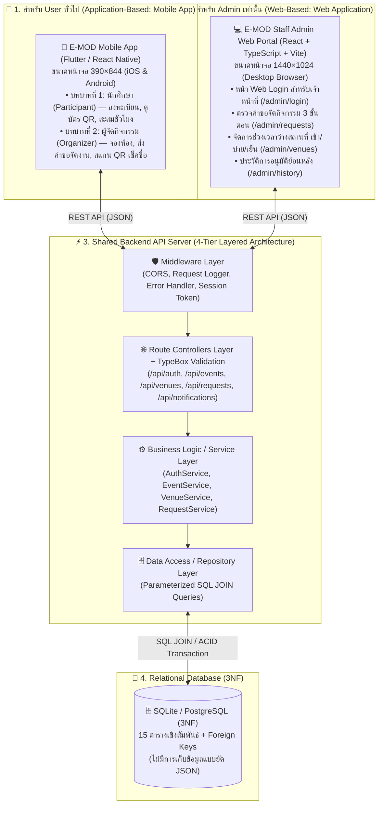

# E-MOD — System Architecture & Tech Stack Design

เอกสารการออกแบบสถาปัตยกรรมระบบ **E-MOD (KMUTT Activity & Venue Management Platform)** โดยแยกแพลตฟอร์มตามบทบาทผู้ใช้งานอย่างชัดเจน:
1. **สำหรับ User ทั่วไป (นักศึกษาผู้เข้าร่วม & ชมรมผู้จัดกิจกรรม):** เป็น **Mobile Application 100% (Application-Based)** — ไม่ใช่ Web App
2. **สำหรับ Admin (เจ้าหน้าที่ฝ่ายกิจการนักศึกษา/ผู้ดูแลสถานที่):** เป็น **Web Application 100% (Web-Based)** บนหน้าจอคอมพิวเตอร์ (`1440 × 1024`)
3. **เชื่อมโยงกันด้วย Backend API & ฐานข้อมูลเชิงสัมพันธ์ (3NF Relational Database) ชุดเดียวกัน**

---

## 1. แผนผังสถาปัตยกรรมระบบ (System Architecture Diagram)



---

## 2. สรุป Tech Stack ที่ออกแบบสำหรับแต่ละส่วน

| ส่วนของระบบ (Component) | ผู้ใช้งานเป้าหมาย | รูปแบบระบบ | Tech Stack ที่ใช้ในโปรเจกต์ | ทางเลือกเทียบเท่าสาย Enterprise |
| :--- | :--- | :--- | :--- | :--- |
| **1. Mobile Application** (`mobile_flutter/` & `mobile/`) | **User ทั่วไป** (นักศึกษา Participant & ชมรม Organizer) | **Application-Based** (iOS / Android App) | **Flutter (Dart)** (`mobile_flutter/`) และ **React Native Expo** (`mobile/`) | Flutter (Dart) / Kotlin & Swift |
| **2. Admin Web Portal** (`frontend/` ที่ `/admin/*`) | **Admin** (เจ้าหน้าที่ดูแลสถานที่ / กิจการนักศึกษา) | **Web Application** (Desktop Browser `1440×1024`) | **React 19 + TypeScript + Vite + History Router** | React.js / Next.js / Angular |
| **3. Backend REST API** (`backend/`) | เชื่อมทั้ง Mobile App และ Admin Web เข้าด้วยกัน | **4-Tier Layered REST API** + OpenAPI Swagger | **ElysiaJS บน Bun Runtime** + TypeBox Schema Validation | Java 21 + Spring Boot 3 (Spring Web, JPA, Security) |
| **4. Relational Database** (`backend/src/db/`) | เก็บข้อมูลกิจกรรม, สถานที่, คำขออนุมัติ, การเช็คชื่อ | **Relational SQL (3NF)** 15 ตาราง | **SQLite 3NF** (`schema.sql` + `seed.ts` + SQL `JOIN` Repositories) | PostgreSQL 16 / MySQL 8 |

---

## 3. การไหลของข้อมูลระหว่าง "แอพมือถือของ User" และ "เว็บของ Admin" (Real-Time Data Flow)

1. **ฝั่งแอพมือถือ (Organizer Mobile App):**
   * ชมรมกดค้นหาสถานที่ว่าง -> กรอกฟอร์มขอจัดกิจกรรม 5 ขั้นตอน + แนบไฟล์ `.pdf` -> กดส่งคำขอ (`POST /api/events`)
   * ระบบสร้างข้อมูลลงตาราง `events`, `event_categories`, และสร้างใบคำขอรหัส `REQ-2026-XXX` ลงตาราง `event_requests` (สถานะ `รออนุมัติ`)
2. **ฝั่งเว็บแอดมิน (Admin Web Application `/admin/requests`):**
   * เจ้าหน้าที่เปิดเว็บผ่านคอมพิวเตอร์ -> เห็นรายการคำขอใหม่เด้งขึ้นมาในตารางทันที (`GET /api/requests`)
   * เจ้าหน้าที่ติ๊กตรวจรายการ 3 จุด (`เอกสารครบถ้วน`, `ข้อมูลถูกต้อง`, `สถานที่ว่าง`) แล้วกด **"อนุมัติคำขอ"** หรือ **"ส่งกลับแก้ไข"** (`PATCH /api/requests/:id/review`)
3. **ซิงค์กลับไปยังแอพมือถือของ User ทันที:**
   * เมื่อ Admin กดอนุมัติบนหน้าเว็บ -> สถานะกิจกรรมในตาราง `events` จะเปลี่ยนเป็น `เปิดรับสมัคร` และส่งแจ้งเตือนเข้าตาราง `notifications` ไปยังแอพมือถือของผู้จัดกิจกรรมทันที
   * นักศึกษาทั่วไปที่เปิดแอพมือถือ (**Participant Mobile App**) จะเห็นกิจกรรมนั้นบนหน้าฟีด กดลงทะเบียน (`POST /api/events/:id/register`) และรับบัตรเข้างาน **QR Code** เพื่อนำไปสแกนหน้างานได้ทันที

---

## 4. โครงสร้างโฟลเดอร์ของโปรเจกต์ทั้งหมด

```text
EMod/
├── mobile_flutter/                  # 📱 1. โปรเจกต์ Flutter Mobile App (Dart) สำหรับ User ทั่วไป
│   ├── pubspec.yaml                 # Dependencies: flutter, http, mobile_scanner, qr_flutter
│   └── lib/
│       ├── main.dart                # โครงแอพมือถือ: Splash -> Mobile Login -> Participant / Organizer
│       ├── core/
│       │   ├── theme/app_colors.dart# สีมาตรฐานจาก Figma (E-MOD / Colors)
│       │   └── services/api_service.dart # เชื่อมต่อ REST API (http://localhost:3001/api)
│       └── models/emod_models.dart  # โมเดลข้อมูล User, Event, Venue
│
├── mobile/                          # 📱 2. โปรเจกต์ React Native (Expo) Mobile App สำหรับ User ทั่วไป
│   ├── App.tsx
│   ├── app.json
│   └── src/screens/                 # LoginScreen, ParticipantScreens (9 หน้า), OrganizerScreens (7 หน้า)
│
├── frontend/                        # 💻📱 3. Admin Web Application (/admin/*) + Mobile OS Simulator (/app)
│   └── src/
│       ├── App.tsx                  # แยกขาด 2 แพลตฟอร์ม: User ทั่วไป = Mobile App | Admin = Web App
│       └── screens/
│           ├── AdminLoginScreen.tsx # 💻 หน้า Web Login สำหรับเจ้าหน้าที่ Admin โดยเฉพาะ (/admin/login)
│           ├── AdminScreens.tsx     # 💻 หน้า Web Application ของ Admin (1440×1024: คำขออนุมัติ, สถานที่, ประวัติ)
│           ├── LoginScreen.tsx      # 📱 หน้า Login ในแอพมือถือสำหรับนักศึกษา/ผู้จัดกิจกรรม
│           ├── ParticipantScreens.tsx # 📱 หน้าจอแอพมือถือฝั่งผู้เข้าร่วมกิจกรรม
│           └── OrganizerScreens.tsx   # 📱 หน้าจอแอพมือถือฝั่งผู้จัดกิจกรรม
│
└── backend/                         # ⚡ 4. Backend API (4-Tier Layered Architecture) + 3NF SQLite
    └── src/
        ├── index.ts                 # Entry Point + OpenAPI Swagger (/swagger)
        ├── config/env.ts            # Environment Config
        ├── middlewares/logger.middleware.ts
        ├── routes/                  # Controller Layer (auth, event, venue, request, support)
        ├── services/                # Business Logic Layer (auth, event, venue, request)
        ├── repositories/            # Data Access Layer (SQL JOINs)
        └── db/
            ├── schema.sql           # 15 ตาราง Relational 3NF (ไม่มีคอลัมน์ JSON)
            ├── connection.ts        # SQLite Connection
            └── seed.ts              # ข้อมูลจำลองเริ่มต้น
```
